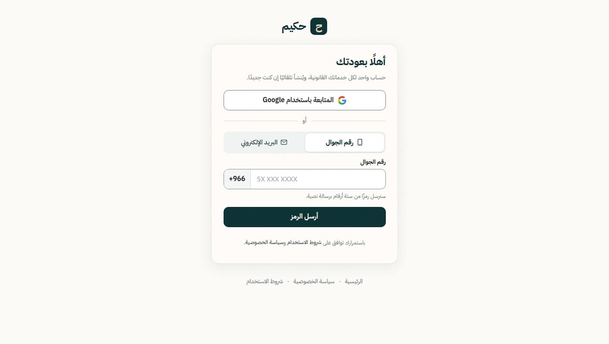

# HKM-002 — فحص واجهة البحث بعد الدخول

**الحالة:** بانتظار الوصول. لم يُحسب نجاحًا.  
**الوقت:** 17 أكتوبر 2026، 09:15 بتوقيت الرياض.  
**الموقع:** `https://hakeemai.net`.  
**ما لم يُفعل:** لم يُعد ملء `search_norm`، ولم تُستدعَ إعادة الفهرسة العامة، ولم تُمس المتجهات، ولم تُنشأ جلسة، ولم يُرسل رمز دخول.

## ما وُجد

لا جلسة. الاستجابة تحمل `x-clerk-auth-status: signed-out` و`x-clerk-auth-reason: session-token-and-uat-missing`. متصفح الفحص بلا ملفات تعريف للموقع، وبيئة الفحص بلا أسماء متغيرات دخول.

| المسار | النتيجة |
|---|---|
| `GET /dashboard/ask` | 307 إلى `/sign-in?next=%2Fdashboard%2Fask` |
| `GET /dashboard/legal-search?q=سلامة` | 307 إلى `/sign-in?next=%2Fdashboard%2Flegal-search`؛ الاستعلام سقط من `next` |
| `GET /dashboard/legal-core/search?q=سلامة` | 307 إلى `/sign-in?next=%2Fdashboard%2Flegal-core%2Fsearch` |

الصورة المنفصلة هي صفحة الدخول نفسها. لا صندوق بحث، ولا نتائج، ولا مادة مفتوحة.

## ما لم يُثبت

- إدخال الاستعلام بعد الدخول.
- ظهور النتائج.
- فتح المادة من نتيجة البحث.
- استبعاد النسخ غير السارية من كامل النتائج المسترجعة.

بحث الموقع العام السابق يعيد صفحة أولى فقط، ولا يُحتسب إثباتًا لهذا الشرط. الدليل الرقمي للإحالات: [hkm-002-login-search.json](hkm-002-login-search.json).
